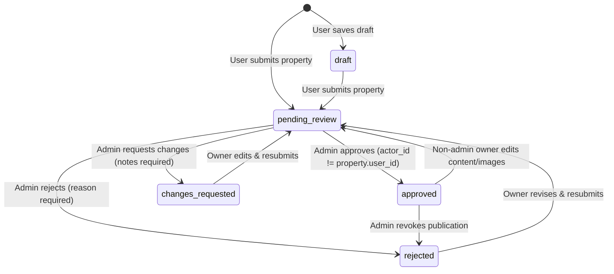

# RESIDENZA — ARCHITECTURE LOCK

> **Document Role**: Binding architectural specification, security boundaries, database schema rules, state machines, and API contracts.
> **Enforcement**: Any deviation from this document requires explicit Architect (Argon 4) and Product Owner sign-off.
> **Last Updated**: 2026-11-08

---

## 1. Repository & Modular Monolith Structure

RESIDENZA uses a **Single-Repository Split-Directory** layout (`d:\resdinza v2`):

```text
d:\resdinza v2\
├── .ai\                        # Architectural governance & agent handoffs
├── backend\                    # Laravel 12 Modular Monolith (PHP 8.3+)
│   ├── app\
│   │   ├── Modules\
│   │   │   ├── Auth\           # Registration, Sanctum session auth, Profile
│   │   │   ├── User\           # User management, Account types, Suspension
│   │   │   ├── Taxonomy\       # Categories & Sohag Locations (Cities/Districts)
│   │   │   ├── Property\       # Core Property CRUD, Availability, Public Search
│   │   │   ├── Moderation\     # Moderation state machine, Audit logs, Reviews
│   │   │   └── Media\          # Public property images & Private document vault
│   │   ├── Http\               # Shared Middleware, Base Controllers, Kernel
│   │   └── Support\            # Shared ApiResponse traits, Enums, Exceptions
│   ├── config\
│   ├── database\
│   │   ├── migrations\
│   │   └── seeders\            # Sohag cities/districts & Real Estate categories
│   ├── routes\
│   │   ├── api.php             # Mounts /api/v1/* module routes
│   │   └── web.php             # Sanctum CSRF cookie route only
│   ├── storage\
│   │   ├── app\public\         # Public property images ONLY (symlinked)
│   │   └── app\private\        # Private verification documents ONLY (NEVER symlinked)
│   └── tests\
└── frontend\                   # Next.js 15 App Router (React 19, TypeScript, Tailwind v4)
    ├── src\
    │   ├── app\
    │   │   ├── (public)\       # Public Marketplace routes (SSR/ISR Arabic SEO)
    │   │   ├── (auth)\         # Login & Registration pages
    │   │   ├── (portal)\       # Authenticated User Portal (/dashboard/*)
    │   │   └── (admin)\        # Restricted Admin Panel (/admin/*)
    │   ├── components\
    │   │   ├── ui\             # RTL-first atomic UI primitives
    │   │   ├── marketplace\    # Property cards, filters, gallery, WhatsApp CTA
    │   │   ├── portal\         # Submission forms, status badges, image uploader
    │   │   └── admin\          # Moderation queue table, review modal, taxonomy CRUD
    │   ├── lib\
    │   │   ├── api\            # Fetch wrapper with Sanctum CSRF + credentials: 'include'
    │   │   ├── auth\           # Auth context / session guard hooks
    │   │   └── utils\          # EGP currency formatter, Arabic date/number helpers
    │   └── types\
    │       └── api.ts          # Strict TypeScript mirrors of Laravel API Resources
    └── public\
```

---

## 2. Authentication, CORS, Cookies, Sessions & CSRF Lock

### 2.1 Authentication Mechanism
- **Primary Mode**: **Laravel Sanctum Stateful SPA Cookie Authentication**.
- **Why**: Avoids storing bearer tokens in `localStorage` (which is vulnerable to XSS). Uses browser-managed `HttpOnly` session cookies paired with Sanctum's `XSRF-TOKEN` cookie.
- **Login Flow**:
  1. Next.js client calls `GET /sanctum/csrf-cookie` with `credentials: 'include'`.
  2. Browser receives `XSRF-TOKEN` cookie (readable by JS) and `residenza_session` cookie (`HttpOnly`).
  3. Next.js client reads `XSRF-TOKEN`, URL-decodes it, and sends it in the `X-XSRF-TOKEN` header on `POST /api/v1/auth/login` (and all subsequent `POST`, `PUT`, `PATCH`, `DELETE` requests).
  4. Server validates credentials, regenerates session ID (`$request->session()->regenerate()`), and returns the authenticated `UserResource`.

### 2.2 Required Environment & CORS Configuration
- **Development Ports**:
  - Backend (Laravel): `http://localhost:8000` (must use `localhost`, NOT `127.0.0.1`, if frontend uses `localhost`, so browser shares site cookie scope).
  - Frontend (Next.js): `http://localhost:3000`.
- **`backend/config/cors.php`**:
  - `paths`: `['api/*', 'sanctum/csrf-cookie']`
  - `allowed_origins`: `[env('FRONTEND_URL', 'http://localhost:3000')]` (Never `'*'`)
  - `supports_credentials`: `true`
- **`backend/.env` Requirements**:
  - `APP_URL=http://localhost:8000`
  - `FRONTEND_URL=http://localhost:3000`
  - `SANCTUM_STATEFUL_DOMAINS=localhost:3000,localhost:8000,localhost`
  - `SESSION_DRIVER=database`
  - `SESSION_DOMAIN=localhost` (in production: `.residenza.eg` or shared root domain)
  - `SESSION_SAME_SITE=lax`
  - `SESSION_SECURE_COOKIE=false` (`true` in HTTPS production)

---

## 3. Database Schema & Entity Constraints (PostgreSQL)

All tables use `BIGINT` auto-incrementing primary keys (`id`) internally, plus human-readable `slug` or `reference_code` (`RES-YYYY-NNNNN`) where appropriate for public URLs. Timestamps are stored in UTC (`timestamptz` / Laravel timestamps).

### 3.1 `users`
| Column | Type | Constraints | Notes |
| :--- | :--- | :--- | :--- |
| `id` | `BIGSERIAL` | PK | |
| `name` | `VARCHAR(150)` | NOT NULL | Full name in Arabic/English |
| `email` | `VARCHAR(255)` | UNIQUE, NOT NULL | Login identifier |
| `phone` | `VARCHAR(25)` | UNIQUE, NOT NULL | Egyptian format (`+201xxxxxxxxx` or `01xxxxxxxxx`) |
| `whatsapp_number` | `VARCHAR(25)` | NULLABLE | Defaults to `phone` if omitted |
| `password` | `VARCHAR(255)` | NOT NULL | Bcrypt/Argon2id hashed |
| `role` | `VARCHAR(20)` | NOT NULL, DEFAULT `'user'` | Enum: `'user'`, `'admin'` |
| `account_type` | `VARCHAR(20)` | NOT NULL, DEFAULT `'individual'` | Enum: `'individual'`, `'broker'`, `'company'`, `'admin'` |
| `company_name` | `VARCHAR(200)` | NULLABLE | Required if `account_type = 'company'` or `'broker'` |
| `status` | `VARCHAR(20)` | NOT NULL, DEFAULT `'active'` | Enum: `'active'`, `'suspended'` |
| `timestamps` | `TIMESTAMP` | | `created_at`, `updated_at` |

### 3.2 `categories`
| Column | Type | Constraints | Notes |
| :--- | :--- | :--- | :--- |
| `id` | `BIGSERIAL` | PK | |
| `name_ar` | `VARCHAR(100)` | NOT NULL | e.g., `شقة سكنية`, `فيلا`, `أرض`, `محل تجاري`, `مقر إداري`, `عمارة كاملة` |
| `name_en` | `VARCHAR(100)` | NULLABLE | Optional English label |
| `slug` | `VARCHAR(120)` | UNIQUE, NOT NULL | URL-safe slug |
| `is_active` | `BOOLEAN` | NOT NULL, DEFAULT `true` | |
| `sort_order` | `INTEGER` | NOT NULL, DEFAULT `0` | |
| `timestamps` | `TIMESTAMP` | | |

### 3.3 `locations` (Sohag Hierarchy)
| Column | Type | Constraints | Notes |
| :--- | :--- | :--- | :--- |
| `id` | `BIGSERIAL` | PK | |
| `parent_id` | `BIGINT` | FK -> `locations.id` NULLABLE | `NULL` = City/Markaz (e.g., مدينة سوهاج، سوهاج الجديدة، أخميم); Non-null = District/Neighborhood (e.g., حي الشرق، الزهراء، الكوثر) |
| `name_ar` | `VARCHAR(120)` | NOT NULL | Arabic name |
| `name_en` | `VARCHAR(120)` | NULLABLE | |
| `slug` | `VARCHAR(150)` | UNIQUE, NOT NULL | |
| `is_active` | `BOOLEAN` | NOT NULL, DEFAULT `true` | |
| `sort_order` | `INTEGER` | NOT NULL, DEFAULT `0` | |
| `timestamps` | `TIMESTAMP` | | |

### 3.4 `properties`
| Column | Type | Constraints | Notes |
| :--- | :--- | :--- | :--- |
| `id` | `BIGSERIAL` | PK | |
| `reference_code` | `VARCHAR(30)` | UNIQUE, NOT NULL | Auto-generated e.g. `RES-2026-00001` |
| `slug` | `VARCHAR(255)` | UNIQUE, NOT NULL | SEO slug + reference suffix |
| `user_id` | `BIGINT` | FK -> `users.id` RESTRICT | Owner / Submitter of the listing |
| `category_id` | `BIGINT` | FK -> `categories.id` RESTRICT | |
| `location_id` | `BIGINT` | FK -> `locations.id` RESTRICT | City or Neighborhood in Sohag |
| `transaction_type` | `VARCHAR(20)` | NOT NULL | Enum: `'sale'` (للبيع), `'rent'` (للإيجار) |
| `title_ar` | `VARCHAR(200)` | NOT NULL | Arabic property title |
| `description_ar` | `TEXT` | NOT NULL | Detailed Arabic description |
| `price_egp` | `NUMERIC(14, 2)` | NOT NULL, CHECK (`price_egp > 0`) | Price in Egyptian Pounds (EGP) |
| `area_sqm` | `NUMERIC(10, 2)` | NOT NULL, CHECK (`area_sqm > 0`) | Area in square meters ($m^2$) |
| `bedrooms` | `SMALLINT` | NULLABLE, CHECK (`bedrooms >= 0`) | `NULL` for land/commercial |
| `bathrooms` | `SMALLINT` | NULLABLE, CHECK (`bathrooms >= 0`) | |
| `floor_level` | `SMALLINT` | NULLABLE | |
| `finishing_type` | `VARCHAR(40)` | NULLABLE | Enum: `'core_and_shell'`, `'semi_finished'`, `'fully_finished'`, `'lux'`, `'super_lux'` |
| `address_details_ar` | `VARCHAR(300)` | NOT NULL | Visible street/landmark description |
| `contact_phone` | `VARCHAR(25)` | NOT NULL | Defaults to owner's phone |
| `contact_whatsapp` | `VARCHAR(25)` | NOT NULL | Defaults to owner's WhatsApp |
| `moderation_status` | `VARCHAR(30)` | NOT NULL, DEFAULT `'pending_review'` | Enum: `'draft'`, `'pending_review'`, `'changes_requested'`, `'approved'`, `'rejected'` |
| `availability_status`| `VARCHAR(20)` | NOT NULL, DEFAULT `'available'` | Enum: `'available'`, `'sold'`, `'rented'`, `'hidden'` |
| `rejection_reason` | `TEXT` | NULLABLE | Latest feedback from Admin |
| `reviewed_by` | `BIGINT` | FK -> `users.id` NULLABLE | Admin who performed latest review |
| `reviewed_at` | `TIMESTAMP` | NULLABLE | |
| `published_at` | `TIMESTAMP` | NULLABLE | Set when first `approved` |
| `is_featured` | `BOOLEAN` | NOT NULL, DEFAULT `false` | Admin-only toggle |
| `timestamps` | `TIMESTAMP` | | `created_at`, `updated_at`, `deleted_at` (SoftDeletes) |

**Required Composite Indexes on `properties`**:
1. `idx_properties_public_marketplace`: `(moderation_status, availability_status, transaction_type, category_id, location_id, published_at DESC)`
2. `idx_properties_price`: `(moderation_status, availability_status, price_egp)`
3. `idx_properties_user`: `(user_id, moderation_status, created_at DESC)`

### 3.5 `property_images` (Public Media)
| Column | Type | Constraints | Notes |
| :--- | :--- | :--- | :--- |
| `id` | `BIGSERIAL` | PK | |
| `property_id` | `BIGINT` | FK -> `properties.id` CASCADE | |
| `disk` | `VARCHAR(20)` | NOT NULL, DEFAULT `'public'` | Must be `'public'` |
| `file_path` | `VARCHAR(500)` | NOT NULL | Relative path on `public` disk |
| `mime_type` | `VARCHAR(50)` | NOT NULL | `image/jpeg`, `image/png`, `image/webp` |
| `file_size_bytes` | `INTEGER` | NOT NULL | Max 5 MB (`5242880` bytes) |
| `is_primary` | `BOOLEAN` | NOT NULL, DEFAULT `false` | Cover photo flag |
| `sort_order` | `SMALLINT` | NOT NULL, DEFAULT `0` | |
| `timestamps` | `TIMESTAMP` | | |

### 3.6 `property_documents` (Private Verification Vault)
| Column | Type | Constraints | Notes |
| :--- | :--- | :--- | :--- |
| `id` | `BIGSERIAL` | PK | |
| `property_id` | `BIGINT` | FK -> `properties.id` CASCADE | |
| `uploaded_by` | `BIGINT` | FK -> `users.id` RESTRICT | |
| `document_type` | `VARCHAR(50)` | NOT NULL | Enum: `'ownership_proof'`, `'broker_authorization'`, `'national_id'`, `'other'` |
| `disk` | `VARCHAR(20)` | NOT NULL, DEFAULT `'local'` | Stored in `storage/app/private` — **NEVER `'public'`** |
| `file_path` | `VARCHAR(500)` | NOT NULL | UUID filename outside webroot |
| `original_name` | `VARCHAR(255)` | NOT NULL | Sanitized display name for Admin |
| `mime_type` | `VARCHAR(80)` | NOT NULL | `application/pdf`, `image/jpeg`, `image/png`, `image/webp` |
| `file_size_bytes` | `INTEGER` | NOT NULL | Max 10 MB (`10485760` bytes) |
| `timestamps` | `TIMESTAMP` | | |

### 3.7 `moderation_logs` (Immutable Audit Trail)
| Column | Type | Constraints | Notes |
| :--- | :--- | :--- | :--- |
| `id` | `BIGSERIAL` | PK | |
| `property_id` | `BIGINT` | FK -> `properties.id` CASCADE | |
| `actor_id` | `BIGINT` | FK -> `users.id` RESTRICT | Admin or Owner who triggered transition |
| `from_status` | `VARCHAR(30)` | NULLABLE | Previous `moderation_status` |
| `to_status` | `VARCHAR(30)` | NOT NULL | New `moderation_status` |
| `action` | `VARCHAR(40)` | NOT NULL | `'submit'`, `'resubmit'`, `'approve'`, `'request_changes'`, `'reject'`, `'edit_reset'` |
| `notes` | `TEXT` | NULLABLE | Required when `action` is `'request_changes'` or `'reject'` |
| `created_at` | `TIMESTAMP` | NOT NULL | Immutable append-only record |

---

## 4. Moderation & Availability State Machines

### 4.1 Moderation State Machine (`moderation_status`)



**Strict Invariants**:
1. **Public Visibility Rule**: A property is visible on public marketplace endpoints (`/api/v1/properties*`) **if and only if**:
   - `moderation_status = 'approved'`
   - `availability_status = 'available'`
   - Owner's `users.status = 'active'`
2. **Self-Approval Guard**:
   - In `ModerationService::approve(Property $property, User $admin)`:
     - Must assert `$admin->role === 'admin'`.
     - If `$property->user_id === $admin->id` AND the property was submitted through the standard user flow, throw `AuthorizationException` unless it is an explicit Admin-created official listing (see Open Decision OD-01 in `ARGON_DECISIONS.md`).
3. **Content Edit Reset Rule**:
   - When a non-admin owner updates any content field (`title_ar`, `description_ar`, `price_egp`, `area_sqm`, `category_id`, `location_id`, `address_details_ar`, or uploads new `property_images`) on an `approved` property, `moderation_status` automatically transitions to `pending_review` and logs an `'edit_reset'` entry in `moderation_logs`.
   - When an owner updates **only** `availability_status` (`available` <-> `sold` / `rented` / `hidden`), `moderation_status` remains untouched (`approved`).

---

## 5. Media & File Upload Security Lock

1. **Dual-Disk Separation**:
   - `public` disk (`storage/app/public/properties/{property_id}/`): Public property photos only.
   - `private` disk (`storage/app/private/property_documents/{property_id}/`): Private verification documents only. **No `storage:link` may ever point to `storage/app/private`**.
2. **Strict Server-Side Validation**:
   - Validate via PHP `finfo` (`mimetypes:` and `mimes:` rules), never trusting the client-supplied `Content-Type` header or file extension alone.
   - Public images: `mimes:jpg,jpeg,png,webp`, max `5120` KB (5 MB), max 15 images per property, dimensions between `300x300` and `6000x6000`.
   - Private documents: `mimes:pdf,jpg,jpeg,png,webp`, max `10240` KB (10 MB), max 5 documents per property.
3. **Filename Randomization**:
   - Never store user-supplied filenames on disk. Generate cryptographically random UUID v4 filenames (`Str::uuid() . '.' . $extension`). Store sanitized original filename only in `property_documents.original_name` for display.
4. **Private Document Access Control**:
   - Served exclusively through `GET /api/v1/documents/{document}/download` protected by `auth:sanctum` and `PropertyDocumentPolicy::view(User $user, PropertyDocument $doc)` which allows **only** `$user->role === 'admin'` or `$doc->uploaded_by === $user->id`.
   - Response headers must include `Content-Disposition: inline; filename="..."`, `X-Content-Type-Options: nosniff`, and `Cache-Control: private, no-store`.

---

## 6. API Structure & Error Contract (`/api/v1/`)

### 6.1 Standard JSON Envelope
All API responses from `/api/v1/*` must adhere to a unified JSON envelope:

**Success Response (`200 OK`, `201 Created`)**:
```json
{
  "success": true,
  "message": "تمت العملية بنجاح",
  "data": { ... },
  "meta": {
    "current_page": 1,
    "last_page": 5,
    "per_page": 12,
    "total": 58
  }
}
```

**Error / Validation Response (`400`, `401`, `403`, `404`, `422`, `500`)**:
```json
{
  "success": false,
  "message": "بيانات الإدخال غير صالحة",
  "error_code": "VALIDATION_ERROR",
  "errors": {
    "price_egp": ["السعر يجب أن يكون رقماً أكبر من الصفر."]
  }
}
```

### 6.2 Core Route Namespaces
- `GET /sanctum/csrf-cookie` — Initialize SPA CSRF protection.
- `/api/v1/auth/*` — `register`, `login`, `logout`, `me` (current user profile).
- `/api/v1/public/*` (or `/api/v1/properties`, `/api/v1/categories`, `/api/v1/locations`) — Anonymous read-only marketplace endpoints. Uses `PublicPropertyResource` which **strips** `user_id`, `reviewed_by`, `rejection_reason`, `moderation_logs`, and `property_documents`.
- `/api/v1/portal/*` (`auth:sanctum`, active user check) — User's own properties CRUD, availability status toggle, image/document upload, profile update.
- `/api/v1/admin/*` (`auth:sanctum`, `EnsureUserIsAdmin` middleware) — Dashboard stats, moderation queue, approve/reject/request-changes actions, private document streaming, categories/locations CRUD, user status management.

---

## 7. Changes Requiring Explicit Architectural Approval

No engineer or subagent may perform any of the following without updating this lock file via Architect review:
1. Adding any third-party infrastructure daemon (Redis, Meilisearch, RabbitMQ, Docker Swarm/K8s, Pusher/WebSockets).
2. Exposing `property_documents` on a public disk or returning document paths in public API responses.
3. Allowing any property with `moderation_status != 'approved'` to appear in public search or public detail endpoints.
4. Bypassing Sanctum CSRF protection on state-changing routes.
5. Introducing payment, subscription, CRM, or AI features excluded from the MVP.
