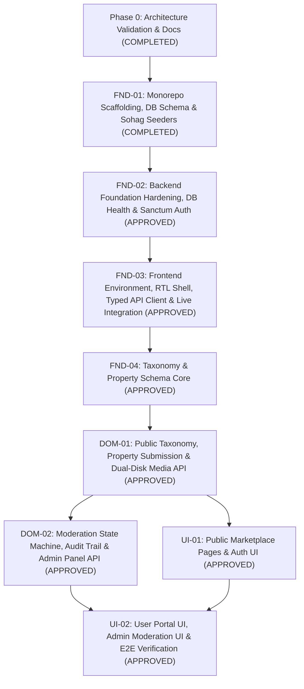

# RESIDENZA — IMPLEMENTATION PLAN

> **Document Role**: Phased implementation roadmap, granular task breakdown, dependencies, acceptance criteria, and execution order for building the RESIDENZA MVP.  
> **Target Audience**: Lead Architect (Argon 4) & Implementation Engineer (Gemini 3.8 Flash).  
> **Last Updated**: 2026-11-16  

---

## 1. Execution Roadmap Overview

---

## 2. Phase 2 — Project Foundation Task Breakdown (`FND-01` to `FND-03`)

### Task `FND-01`: Monorepo Scaffolding, Core Database Schema & Sohag Taxonomy Seeding
- **Status**: **`COMPLETED & APPROVED`** (`2026-11-09`)
- **Delivered**:
  - Root Git repository and `.gitignore`.
  - `/backend` Laravel 12 Modular Monolith directory structure, 8 PHP 8.3 Backed Enums, `ApiResponse` envelope helper, Dual-Disk storage (`public` + `private`), 7 core database migrations with composite indexes, Eloquent models, `AdminUserSeeder`, `SohagTaxonomySeeder`, and `FoundationTest.php`.
  - `/frontend` Next.js 15.2 + React 19 + TypeScript + Tailwind CSS v4 scaffold, `<html lang="ar" dir="rtl">`, route group folders, and `src/types/api.ts`.

---

### Task `FND-02`: Backend Foundation Hardening, DB Health Verification & Sanctum Auth Foundation
- **Status**: **`COMPLETED & APPROVED`** (Passed Second Independent Review on `2026-11-09`)
- **Dependencies**: `FND-01`
- **Delivered**:
  - Stripped sample `APP_KEY` from `backend/.env.example`, synced `backend/.env`, locked `SESSION_COOKIE=residenza-session` and `SESSION_DOMAIN=null` for localhost development, and documented PostgreSQL + SQLite configuration blocks.
  - Aligned `UserFactory.php` with custom `users` schema (`broker()`, `company()`, `admin()`, `suspended()` states).
  - Upgraded `GET /api/v1/health` with live `DB::select('SELECT 1')` connectivity verification (`200 OK` / `503 Service Unavailable`).
  - Implemented centralized JSON exception rendering in `bootstrap/app.php` (`401`, `403`, `404`, `405`, `419`, `422`, `429`, `HttpResponseException`, 4xx `HttpExceptionInterface`, and non-leaking generic `500` handler).
  - Implemented rate-limited (`throttle:10,1`) Stateful Sanctum authentication endpoints (`/api/v1/auth/register`, `login`, `logout`, `me`), RBAC middlewares (`EnsureUserIsActive`, `EnsureUserIsAdmin`), and hardened `PUT /api/v1/portal/profile`.
  - Verified with `19 passed (144 assertions)` in `php artisan test`.

---

### Task `FND-03`: Frontend Environment, RTL Layout Shell, Typed API Client & Live Frontend-to-Backend Integration
- **Status**: **`APPROVED & COMPLETE`** (Closed by Argon 4 on 2026-11-10)
- **Dependencies**: `FND-01`, `FND-02`
- **Results**: Frontend build passes (Exit 0), TypeScript clean (Exit 0), RTL Logical CSS scan passes, Live Health/CORS passes, and Stateful Cookie-Jar Sanctum Lifecycle passes (3/3). Root `README.md` created. Backend regression tests: 19 passed (144 assertions).

---

### Task `FND-04`: Taxonomy & Property Schema Core (Revision 5.4.2 — Final Bounded Specification)
- **Status**: **`APPROVED`** (`2026-11-15` | Independent Audit Verdict: **`PASS — READY FOR ARCHITECTURAL ACCEPTANCE`** | Backend `34 passed (243 assertions)`, Frontend `tsc --noEmit` `0 errors` | PostgreSQL triggers/DDL statically implemented and remain **`UNVERIFIED ON LIVE POSTGRESQL`** | `FND-05`: **`NOT STARTED — SPECIFICATION REVIEW PENDING`**)
- **Dependencies**: `FND-01` (Approved), `FND-02` (Approved), `FND-03` (Approved)
- **Specification Document**: `.ai/ARGON_TO_FLASH.md` (Revision 5.4.2)
- **Authorized Scope**: **19 files** (including Product Owner-approved `backend/tests/Feature/FoundationTest.php` as File #19).
- **Locked Decisions**: `OD-01 = A` (Admin direct publish with unconditional `published_at = now()`, no scheduled publication, and atomic `admin_direct_publish` log), `OD-05 = A` (`down_payment_egp` permits `NULL` and `0.00`, positive `< price_egp`). `UD-01` and `UD-02` remain unresolved future decisions outside `FND-04` scope.
- **Scope & Key Deliverables**:
  1. Additive schema migration with **Conservative Step 0 Preflight Refusal Gate** preventing loss of meaningful data (14 property attributes, subcategories, modified/custom category `property_type`, modified location `type`, sequence reissuance, unexpected NULL states).
  2. Documented SQLite DDL non-atomicity limitation, operational backup integrity verification requirement (online backup/.backup or safe WAL checkpoint, PRAGMA quick_check == 'ok', PRAGMA foreign_key_check == 0 rows), and manual recovery procedures.
  3. Reversible Sohag data restoration in `down()` returning the 13 original roots to `parent_id = null` and removing the 3 newly added location nodes.
  4. Conditional atomic sequence upsert (`WHERE current_sequence < 999999999999`) throwing clean `\OverflowException` at maximum bound without triggering database `CHECK` errors.
  5. Dedicated transaction retry coordinator managing level-0 SQLite unwinding, `PRAGMA busy_timeout = 5000;`, safe driver-aware error classification (excluding generic HY000), and bounded randomized jitter backoff (10–50ms, max 5 attempts).
  6. Forensic reconciliation of 35 existing location records to 38 total records (`1 root + 14 direct children + 1 under markaz-sohag + 22 under cities/marakiz`).
  7. Moderation log append-only triggers and SQLite parent force-delete cascade verification classified truthfully as design expectations pending test execution.
  8. Planned 15-test matrix with explicit **`UNVERIFIED ON LIVE POSTGRESQL`** classification for all PostgreSQL-specific behaviors.

---

## 3. Subsequent MVP Domain & UI Tasks (Post-Foundation)

Once `FND-04` is approved and implemented, Phase 2 closes and implementation proceeds to Phase 3:

- **Task `DOM-01` (Phase 3)**: **`APPROVED`** (`2026-11-15` | Independent Audit Verdict: **`PASS — READY FOR ARCHITECTURAL ACCEPTANCE`** [0 defects] | Strict 24-file scope; `UD-01 = A`, `UD-02 = B` `installment_price_egp` + `OD-05` alignment; Public Taxonomy `/api/v1/categories`, `/api/v1/locations`, User Portal Property Submission CRUD `/api/v1/portal/properties`, Availability Status Toggle, Content-Edit Moderation Reset Rule, Dual-Disk Media Upload with `finfo` + UUID v4, and Public Marketplace Search/Detail API `PublicPropertyResource`; Backend `43 passed (343 assertions)`, Frontend `tsc --noEmit` `0 errors`; PostgreSQL triggers/DDL remain **`UNVERIFIED ON LIVE POSTGRESQL`**).
- **Task `DOM-02` (Phase 4)**: **`APPROVED`** (`2026-11-15` | Independent Audit Verdict: **`PASS — READY FOR ARCHITECTURAL ACCEPTANCE`** [0 defects] | Strict 22-file scope; `ModerationService` + `OD-01 = A` direct publish + Self-Approval Guard, `PropertyDocumentPolicy` + `/api/v1/documents/{document}/download` private streaming, Admin Dashboard, Admin Property/User/Taxonomy CRUD; Backend `50 passed (409 assertions)`, Frontend `tsc --noEmit` `0 errors`; PostgreSQL triggers/DDL remain **`UNVERIFIED ON LIVE POSTGRESQL`**).
- **Task `UI-01` (Phase 5)**: **`APPROVED`** (`2026-11-16` | Warm Living Luxury & Organic Motion design direction signed off by Product Owner | Independent Audit & Deep Spec Review Verdict: **`PASS`** (`0` critical/high/medium defects) | Strict 26-file scope; Warm Living Luxury theme (`#FAF7F2`, `#F3EDE2`, `#131E26`, `#C59B4E`), 6 UI primitives, `AuthContext` Sanctum SPA cookie hook, `public.ts` API helpers (`cache: 'no-store'`), 5 marketplace components (`PropertyCard`, `PropertyFilters`, `PropertyGallery`, `PricingBreakdown` with `UD-02 = B` & `OD-05 = A`, `ContactCtaCard` with `"معتمد للنشر"`), Homepage, `/properties`, `/properties/[slug]`, `/categories`, `/locations`, `/about`, `/contact`, `/login`, `/register`; Frontend `tsc --noEmit` `0 errors`, Static RTL Logical CSS test `PASS`; PostgreSQL triggers/DDL remain **`UNVERIFIED ON LIVE POSTGRESQL`**).
- **Task `UI-02` (Phase 6)**: **`APPROVED`** (`2026-11-16` | Independent Read-Only Architectural, Security & Spec Audit Verdict: **`PASS — READY FOR FINAL PRODUCT OWNER ACCEPTANCE`** [0 defects] | Strict 19-file scope in `frontend/src/`; User Portal UI (`/portal`, `/portal/properties/new`, `/portal/properties/[id]/edit`, `/portal/profile`) and Admin Panel UI (`/admin`, `/admin/properties`, `/admin/properties/new` [`OD-01 = A`], `/admin/properties/[id]` [Self-Approval Guard + private document streaming], `/admin/users` [Self-Suspension Guard], `/admin/taxonomy`); Frontend `tsc --noEmit` `0 errors`, Static RTL Logical CSS test `PASS`; PostgreSQL triggers/DDL remain **`UNVERIFIED ON LIVE POSTGRESQL`**).
- **Full RESIDENZA v2 MVP Application Scope (`FND-01` through `UI-02`)**: **`ALL PHASES APPROVED & COMPLETE`** (`2026-11-16` | Operational Deployment Note: PostgreSQL-specific triggers/DDL remain **`UNVERIFIED ON LIVE POSTGRESQL`** until production PostgreSQL provisioning).
